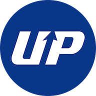

# AlgoRover

> **AlgoRover는 Codex, Claude Code, Cursor에서 전략 연구, 재현 가능한 백테스트, 로컬 실행을 지원하는 무료 AI 퀀트 도구입니다.**
>
> 4,000개 이상의 트레이딩 전략을 탐색하고, AI 대화로 전략을 수정하며, 재현 가능한 백테스트와 거래소 모의거래, 사용자가 승인한 실거래를 실행할 수 있습니다.
>
> **인증 정보:** API 키는 로컬에 보관됩니다. **Runtime:** 사용자 컴퓨터 또는 본인 소유 VPS에서 실행합니다. **라이선스:** 플러그인 매니페스트, 설정, 문서는 MIT 라이선스이며 Runtime은 독점 소프트웨어입니다.

[English](README.md) · [简体中文](README.zh-CN.md) · [한국어](README.ko.md)

<picture>
  <source media="(prefers-color-scheme: dark)" srcset="./readme-assets/algorover-logo-white.svg">
  
</picture>

[웹사이트](https://algorover.ai) · [Live 가이드](https://algorover.ai/en/live/) · [전략 라이브러리](https://algorover.ai/en/strategies/) · [전략 검증 자료](https://algorover.ai/en/evidence/) · [보안](https://algorover.ai/en/security/) · [블로그](https://blog.algorover.ai/)

[기능](#기능) · [빠른 시작](#빠른-시작) · [작업 흐름](#작업-흐름) · [호환성](#실행-요구-사항과-호환성) · [보안](#보안과-제어) · [자주 묻는 질문](#자주-묻는-질문) · [지원](#문서와-지원) · [라이선스](#라이선스)

[X / Twitter](https://x.com/AlgoRoverQuant) · [Discord](https://discord.gg/DvsA8gQ3Y) · [Telegram](https://t.me/+TGpYk0NlbD4zYTVk)


전략에 대한 질문을 설명하고 검증 자료를 확인한 뒤, 로컬 Dashboard에서 결과를 검토하세요.

## AlgoRover란?

AlgoRover는 이전에 EdgePilot이라는 이름으로 제공되었으며, AI 작업 환경의 자연어 요청을 로컬 전략 연구 및 실행 도구에 연결합니다. 라이브러리에는 숙련된 트레이더가 공유한 전략을 포함해 4,000개 이상의 전략이 있습니다. 전략을 탐색하고 검증 자료를 확인한 다음 한 번의 클릭으로 설치할 수 있습니다.

AI 대화로 거래 규칙, 매개변수, 시장, 위험 한도를 수정할 수 있습니다. 외부 전략을 가져오거나 자신의 아이디어를 구현해 재현 가능한 과거 데이터 백테스트로 검증할 수도 있습니다.

AlgoRover Live는 공개 시장 데이터로 전략 탐색, 설정, 비교, 백테스트를 수행합니다. 데이터와 보고서는 로컬에 보관됩니다. 본인의 거래소 계정을 API로 연결하면 거래소 모의거래와 자동 실거래를 사용할 수 있습니다. 실거래를 시작하려면 사용자가 전략과 위험 설정을 확인하고 승인해야 합니다.

기존 설치에는 **EdgePilot** 이름과 `edgepilot` 식별자가 남아 있을 수 있습니다. 이름 변경 때문에 재설치하거나 설정 이름을 바꿀 필요는 없습니다. 새로 설치할 때는 아래 AlgoRover 명령을 사용하세요.

## 기능

| 기능 | AlgoRover Live |
| :--- | :---: |
| 전략 탐색 및 설정 | ✓ |
| 과거 데이터 백테스트 | ✓ |
| 전략 결과 및 보고서 | ✓ |
| 거래소 모의거래 | ✓ |
| 실거래 | ✓ |
| 거래 인증 정보 | 필요한 경우 로컬에서 설정 |

[AlgoRover Live 살펴보기](https://algorover.ai/en/live/)

## 무엇을 할 수 있나요?

### 검증할 전략 찾기

4,000개 이상의 전략을 자산, 출처, 시간 주기로 필터링하고, 규칙과 과거 검증 자료를 살펴본 뒤 후보를 비교해 설치하세요.

```text
BTC 1시간 주기에 대해 검토할 전략 세 개를 찾아줘. 거래 규칙, 필요한 데이터, 주요 위험, 현재 검증 자료를 설명해줘. 주문은 넣지 마.
```

### 전략 수정 또는 외부 전략 가져오기

AI 대화로 거래 규칙, 매개변수, 시장, 위험 한도를 수정하세요. 외부 전략을 가져와 자신의 버전으로 만든 뒤 실행 전에 백테스트할 수 있습니다.

```text
이 전략의 로컬 사본을 만들고 BTC 1시간 주기에 맞춰 수정해줘. 규칙과 매개변수의 변경 사항을 설명하고, 수수료와 슬리피지를 명시해서 백테스트해줘. 주문은 넣지 마.
```

### 수익률 이외의 백테스트 지표 검토

결론을 내리기 전에 테스트 기간, 데이터, 비용, 낙폭, 강건성을 확인하세요.

```text
이 백테스트의 데이터 출처, 테스트 기간, 매개변수, 수수료, 슬리피지, 최대 낙폭, 한계를 검토해줘. 결과를 신뢰하기 전에 추가로 확인할 사항도 알려줘.
```

### 모의거래 준비

실행 전에 호환성과 운영 한도를 확인하세요.

```text
AlgoRover Live로 이 전략이 선택한 거래소의 Demo 모드를 지원하는지 확인해줘. 필요한 설정, 포지션 한도, 중단 조건을 정리해줘. 아직 실행하지 마.
```

## 빠른 시작

사용하는 AI 작업 환경을 선택하고 AlgoRover Live를 설치하세요.

### Codex

```bash
codex plugin marketplace add Frederica123/algorover-hub --ref main
codex plugin add algorover@algorover
```

### Claude Code

```bash
claude plugin marketplace add Frederica123/algorover-hub@main
claude plugin install algorover@algorover
```

### Cursor

Cursor 전용 플러그인 디렉터리를 사용하세요.

| 플러그인 | 플러그인 디렉터리 |
| :--- | :--- |
| AlgoRover Live | `plugins/cursor/algorover` |

이 디렉터리를 Cursor의 로컬 플러그인 디렉터리에 복사한 뒤 창을 다시 로드하세요.

| 플랫폼 | 로컬 플러그인 디렉터리 |
| :--- | :--- |
| macOS 및 Linux | `~/.cursor/plugins/local/` |
| Windows | `%USERPROFILE%\.cursor\plugins\local\` |

각 AI 도구는 해당 도구 전용 플러그인과 호스트 설정을 사용합니다. Teams 또는 Enterprise에서는 **Dashboard → Plugins and MCPs**에서 저장소를 가져올 수 있습니다.

### 첫 세션 시작

설치 후 플러그인을 다시 로드하거나 새 세션을 열고 다음과 같이 요청하세요.

```text
AlgoRover Live를 설정하고 Dashboard를 연 다음 대화형 전략 안내를 시작해줘. 거래는 시작하지 마.
```

설정 안내를 따르세요. 플러그인 설치와 Runtime 시작은 별도의 단계입니다.

## 작업 흐름

| 단계 | 할 일 | 확인할 사항 |
| :--- | :--- | :--- |
| 탐색 | 시장에 대한 질문 설명 | 전략 규칙과 검증 자료 |
| 설정 | 시장, 시간 주기, 매개변수 지정 | 데이터 가용성과 가정 |
| 백테스트 | 과거 데이터 테스트 요청 | 비용, 낙폭, 강건성 |
| 검토 | 보고서 확인 | 재현 가능성과 한계 |
| 실행 | 지원되는 실행 모드 설정 | 권한, 한도, 중단 조건 |

과거 결과와 시뮬레이션 결과는 미래 성과를 보장하지 않습니다.

## 동작 방식

| 구성 요소 | 역할 |
| :--- | :--- |
| AI 작업 환경 | 작업을 설명하고 응답 검토 |
| AlgoRover 플러그인 | 지원되는 요청을 로컬 Runtime에 연결 |
| 로컬 Runtime | 전략 연구, 백테스트, 지원되는 거래 작업 수행 |
| Dashboard | 설정, 결과 확인, 실행 제어 |

이 저장소는 플러그인 배포용 마켓플레이스입니다. Runtime은 AlgoRover Live의 공개 배포 채널에서 별도로 다운로드됩니다.

## 실행 요구 사항과 호환성

- 호스트 환경에서 Node.js를 실행할 수 있어야 합니다.
- AI 작업 환경이 필요한 플러그인과 로컬 프로세스를 허용해야 합니다.
- Runtime 호환성은 운영체제와 배포 채널에 따라 달라집니다.
- Live 로그인과 인증 정보 설정은 Dashboard에서 진행합니다.

설치 전에 [Live 가이드](https://algorover.ai/en/live/)를 확인하세요.

### 거래소 호환성

다음 15개 거래 플랫폼에 대해 계정 조회와 거래 실행 연동을 제공합니다.

| 거래소 또는 브로커 | 계정 조회 | 거래 실행 연동 |
| :--- | :---: | :---: |
|  Alpaca | ✓ | ✓ |
|  Aster | ✓ | ✓ |
|  Binance | ✓ | ✓ |
|  Bitget | ✓ | ✓ |
|  Bithumb | ✓ | ✓ |
|  Bybit | ✓ | ✓ |
|  Deribit | ✓ | ✓ |
|  dYdX | ✓ | ✓ |
|  Gate.io | ✓ | ✓ |
|  Hyperliquid | ✓ | ✓ |
|  Kalshi | ✓ | ✓ |
|  Lighter | ✓ | ✓ |
|  Longbridge | ✓ | ✓ |
|  OKX | ✓ | ✓ |
|  Upbit | ✓ | ✓ |

사용 가능한 거래 모드는 설치된 어댑터와 계정 환경에 따라 달라집니다. Longbridge를 사용하려면 이를 지원하는 Runtime이 필요합니다.

## 보안과 제어

- Live API 키와 거래 인증 정보는 로컬에 보관됩니다.
- 실거래를 시작하려면 사용자가 전략과 위험 설정을 확인하고 승인해야 합니다.
- 자금은 사용자의 거래소 계정에 유지되며, AlgoRover는 사용자 자금을 수탁하지 않습니다.

[보안 안내](https://algorover.ai/en/security/), [개인정보 처리방침](https://algorover.ai/privacy/), [서비스 약관](https://algorover.ai/terms/)을 확인하세요.

## 자주 묻는 질문

### 플러그인을 설치하면 바로 거래가 시작되나요?

아니요. 설치만으로 거래가 시작되지는 않습니다. Runtime 설정과 거래 실행은 별도의 작업입니다.

### 플러그인을 설치했는데 Runtime을 사용할 수 없어요.

플러그인을 다시 로드하거나 새 세션을 연 다음 AlgoRover 설정을 요청하세요. 호스트가 로컬 프로세스를 지원하는지, 사용 중인 플랫폼이 지원되는지 확인하세요.

### `runtime_identity_incompatible`은 무슨 뜻인가요?

플러그인을 업데이트하고 세션을 다시 로드하세요. Runtime 복구로는 플러그인에 바인딩된 Runtime 식별 정보를 변경할 수 없습니다.

## 문서와 지원

| 자료 | 용도 |
| :--- | :--- |
| [Live 가이드](https://algorover.ai/en/live/) | 모의거래와 실거래 실행 절차 |
| [전략 라이브러리](https://algorover.ai/en/strategies/) | 전략 탐색, 비교, 설치 |
| [전략 검증 자료](https://algorover.ai/en/evidence/) | 재현 가능한 연구와 스트레스 테스트 |
| [보안](https://algorover.ai/en/security/) | 인증 정보, 데이터, 제어 범위 |
| [블로그](https://blog.algorover.ai/) | 연구 방법과 예제 |
| [GitHub Issues](https://github.com/Frederica123/algorover-hub/issues) | 설치 문제 및 플러그인 버그 |

문제를 신고할 때는 플러그인 버전, AI 도구, 운영체제, 재현 단계, 민감한 정보를 제거한 오류 메시지를 포함하세요. 인증 정보, 토큰, 개인 계정 정보는 포함하지 마세요.

## 라이선스

플러그인 매니페스트, 설정 파일, 문서는 [MIT 라이선스](LICENSE)를 따릅니다. 정확한 적용 파일과 서드파티 고지는 [라이선스 범위](LICENSE-SCOPE.md)를 확인하세요.

AlgoRover Runtime은 별도로 배포되는 독점 소프트웨어입니다. MIT 허용 범위에는 Runtime 소스 및 바이너리, 거래 및 백테스트 엔진, 플러그인에 포함된 `resolver.mjs`와 `bootstrap.mjs` 연동 코드가 포함되지 않습니다. Runtime 사용에는 해당 이용 조건과 [AlgoRover 서비스 약관](https://algorover.ai/terms/)이 적용됩니다.

## 배포 및 릴리스 기록

이 마켓플레이스는 소스 저장소의 `./build.sh marketplace-sync` 명령으로 프로덕션 플러그인 ZIP에서 생성됩니다. `release.json`은 입력 아카이브와 생성된 플러그인의 해시를 기록합니다. 이 저장소에는 인증 정보, Runtime, 사용자 상태를 저장하지 않습니다.

README 이미지는 `readme-assets/`에, 플러그인 아이콘은 각 플러그인의 `assets/`에 있습니다. 새 설치의 마켓플레이스 ID는 `algorover`입니다.

## 플러그인 유지 관리

각 `plugins/<assistant>/algorover` 디렉터리는 해당 AI 도구만 지원합니다. 해당 도구의 매니페스트와 MCP 실행 설정만 유지하고, resolver와 VPS 복사 목록에서도 같은 매니페스트를 읽어야 합니다. 스킬 문서에는 해당 AI 도구의 이름을 사용하세요. Runtime 코드, 탐색 스키마, 배포 바인딩, 아이콘은 AI 도구 간에 공유할 수 있습니다. 마켓플레이스와 릴리스 기록에는 `algorover` Live 플러그인만 배포합니다.

플러그인을 생성하거나 수정한 후 실행하세요.

```bash
node scripts/check-plugins.mjs
node --test tests/plugins.test.mjs
```

상위 `marketplace-sync` 생성기에도 같은 AI 도구별 분리 규칙을 적용하세요. 수정 후에는 `release.json`에서 생성된 디렉터리의 해시를 갱신합니다. 입력 아카이브 해시와 소스 콘텐츠 해시는 원본 릴리스 ZIP을 나타냅니다.
